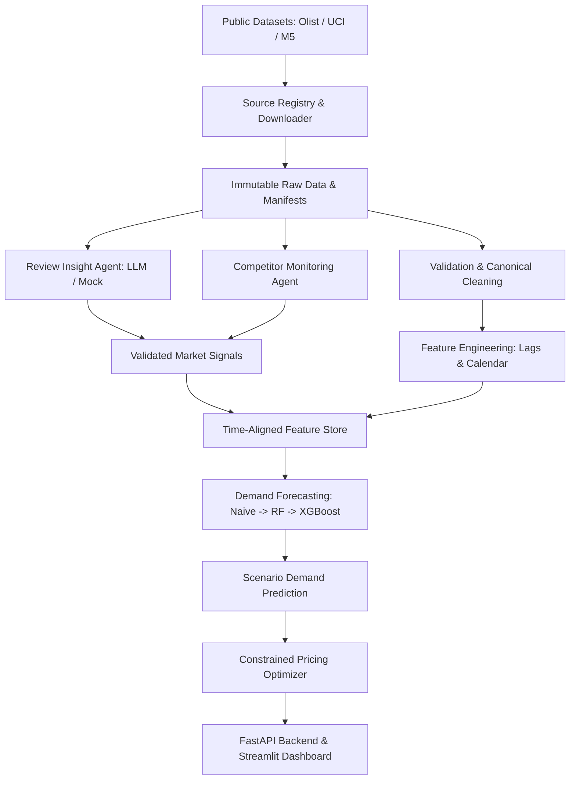

# MarketLens AI — Agentic Dynamic Pricing Intelligence Platform

> **Status:** Under Active Development (Phase 0 Complete)  
> **Source of Truth:** Refer to [MARKETLENS_AI_KNOWLEDGE_BASE.md](file:///d:/Professional%20Projects/Agentic_Dynammic_Intelligence_Platform/MARKETLENS_AI_KNOWLEDGE_BASE.md) for complete technical specifications, mathematical definitions, and architectural policies.

---

## 1. Project Overview

**MarketLens AI** is a hybrid Data Science, Machine Learning, and Generative AI decision-support platform for e-commerce and retail pricing. It combines historical sales transaction data, time-aligned customer review sentiment, and observed competitor price movements to forecast demand under candidate prices and produce constrained, auditable pricing recommendations.

MarketLens AI operates strictly on an **evidence-based decision-support model**; recommendations are designed for human review and approval, and the platform does not execute automated live price changes.

---

## 2. Problem Statement

Retail pricing decisions are complex. Sales demand is driven by historical seasonality, price elasticity, promotions, inventory levels, competitor pricing, and qualitative customer sentiment. Traditionally, these signals are trapped in disparate silos:
- Historical demand models ignore qualitative review sentiment and competitor dynamics.
- Manual competitor price matching lacks demand-elasticity context and risks margin erosion.
- Blind price increases risk brand damage and customer churn.

Businesses need an auditable, integrated system that unifies historical sales and validated external signals to predict demand across feasible prices, evaluate trade-offs between revenue and profit objectives, and operate within strict business constraints.

---

## 3. High-Level Architecture

The platform follows a modular, layered architecture:



### Key Architectural Layers:
1. **Source Discovery & Data Engineering:** Provenance tracking, automated bounded downloads, integrity validation, and canonical schema mapping.
2. **Market Intelligence:** Schema-validated review sentiment/aspect extraction and deterministic competitor price change detection.
3. **Demand Forecasting:** Chronological validation splits, time-aware feature engineering, baseline comparisons, and 4-way feature ablation.
4. **Pricing Optimization:** Non-linear expected revenue and estimated profit evaluation with hard business constraints (min margin, max step changes, supported training bounds).
5. **Product & Serving:** FastAPI REST endpoints and an analytical Streamlit dashboard with full provenance indicators.

---

## 4. Technology Stack

- **Core & Runtime:** Python 3.10+ (tested on Python 3.13)
- **Data Engineering:** Pandas, NumPy, PyYAML, Python-Dotenv
- **Machine Learning & Modeling:** Scikit-learn, XGBoost
- **API Backend:** FastAPI, Pydantic v2, Uvicorn
- **Frontend Dashboard:** Streamlit
- **Testing & Quality:** Pytest, Pytest-cov

---

## 5. Repository Structure

```text
Agentic_Dynammic_Intelligence_Platform/
│
├── MARKETLENS_AI_KNOWLEDGE_BASE.md  # Comprehensive project source of truth
├── README.md                        # Project documentation and guide
├── pyproject.toml                   # Project metadata and dependency definitions
├── .gitignore                       # Rigorous Git exclusions (data, secrets, models)
├── .env.example                     # Environment configuration template
│
├── configs/                         # Modular YAML configurations
│   ├── app.yaml                     # Application & storage settings
│   ├── datasets.yaml                # Source registry & acquisition parameters
│   ├── forecasting.yaml             # Modeling, splits, and evaluation metrics
│   ├── pricing.yaml                 # Optimization objectives & margin constraints
│   └── agents.yaml                  # Agent settings & LLM provider configurations
│
├── data/                            # Segregated data storage (ignored by git)
│   ├── raw/                         # Immutable downloaded source files
│   ├── interim/                     # Intermediate transformations
│   ├── processed/                   # Canonical schema datasets
│   ├── external/                    # External references
│   └── manifests/                   # Dataset provenance catalogs & checksums
│
├── docs/                            # In-depth technical documentation
│   └── development_setup.md         # Step-by-step setup guide
│
├── scripts/                         # Command-line utility scripts
├── src/marketlens/                  # Production application package
│   ├── __init__.py                  # Package definition
│   ├── config.py                    # Safe YAML config loader & env resolver
│   └── logging_config.py            # Idempotent logging setup
│
├── tests/                           # Test suite
│   ├── conftest.py                  # Pytest fixtures and cleanup
│   └── unit/                        # Deterministic unit tests
│       ├── test_config.py           # Configuration tests
│       └── test_logging_config.py   # Logging system tests
│
├── dashboard/                       # Streamlit application (Phase 6)
└── artifacts/                       # Trained models, plots, reports (ignored by git)
```

---

## 6. Quick Start & Setup

### Prerequisites
- Python 3.10+ installed
- Git installed
- Windows PowerShell or Unix Shell

### Installation Steps

1. **Clone the repository:**
   ```bash
   git clone https://github.com/Gokulnaath-N/MarketLens-Agentic-Dynamic-Pricing-Intelligence-Platform.git
   cd MarketLens-Agentic-Dynamic-Pricing-Intelligence-Platform
   ```

2. **Create and activate a virtual environment:**
   ```powershell
   # Windows PowerShell:
   python -m venv .venv
   .\.venv\Scripts\Activate.ps1
   ```

3. **Install the package in editable mode with development dependencies:**
   ```powershell
   python -m pip install --upgrade pip
   pip install -e ".[dev]"
   ```

4. **Initialize environment variables:**
   ```powershell
   Copy-Item .env.example .env
   ```

5. **Execute tests to verify installation:**
   ```powershell
   python -m pytest
   ```

For detailed PowerShell instructions and troubleshooting, see [docs/development_setup.md](file:///d:/Professional%20Projects/Agentic_Dynammic_Intelligence_Platform/docs/development_setup.md).

---

## 7. Security & Operating Principles

1. **Zero Hardcoded Secrets:** API keys and credentials must reside exclusively in local `.env` files; never commit credentials or raw customer review data.
2. **Deterministic Foundations:** arithmetic, constraint validation, and optimization are strictly deterministic; LLMs are bounded to structured language extraction and explanation.
3. **No Synthetic Misrepresentation:** Any mock competitor data or simulated cost feeds are explicitly tagged with `is_synthetic = True` and excluded from model accuracy metrics.
4. **Chronological Integrity:** All feature calculations strictly precede the forecast origin $t$ to eliminate lookahead data leakage.

---

## 8. Development Roadmap

| Phase | Description | Status |
| :---: | :--- | :---: |
| **0** | **Repository Foundation & Environment Setup** | **Completed** |
| **1** | Automated Dataset Discovery & Acquisition | Up Next |
| **2** | Canonical Data Processing & Baseline Demand Forecasting | Planned |
| **3** | Constrained Pricing Optimization Engine | Planned |
| **4** | Market Intelligence Workflows (Reviews & Competitor Agents) | Planned |
| **5** | Hybrid Feature Evaluation & 4-Way Model Ablation | Planned |
| **6** | FastAPI Backend & Interactive Streamlit Dashboard | Planned |
| **7** | Production Hardening, Documentation & MLOps | Planned |
