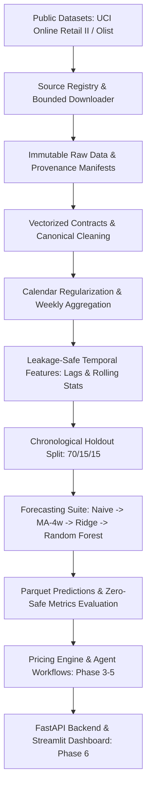

# MarketLens AI — Agentic Dynamic Pricing Intelligence Platform

> **Status:** Under Active Development (Phase 2 Complete: Canonical Data Modeling, Leakage-Safe Feature Engineering & Baseline Demand Forecasting)  
> **Source of Truth:** Refer to [MARKETLENS_AI_KNOWLEDGE_BASE.md](file:///d:/Professional%20Projects/Agentic_Dynammic_Intelligence_Platform/MARKETLENS_AI_KNOWLEDGE_BASE.md) for complete technical specifications, mathematical definitions, and architectural policies.

---

## 1. Project Overview

**MarketLens AI** is a hybrid Data Science, Machine Learning, and Generative AI decision-support platform for e-commerce and retail pricing. It combines historical sales transaction data, time-aligned customer review sentiment, and observed competitor price movements to forecast demand under candidate prices and produce constrained, auditable pricing recommendations.

MarketLens AI operates strictly on an **evidence-based decision-support model**; recommendations are designed for human review and approval, and the platform does not execute automated live price changes.

---

## 2. Problem Statement

Retail pricing decisions are complex. Sales demand is driven by historical seasonality, price elasticity, promotions, inventory levels, competitor pricing, and qualitative customer sentiment. Traditionally, these signals are trapped in disparate silos:
- Historical demand models ignore qualitative review sentiment and competitor dynamics.
- Manual competitor price matching lacks demand-elasticity context and risks margin erosion.
- Blind price increases risk brand damage and customer churn.

Businesses need an auditable, integrated system that unifies historical sales and validated external signals to predict demand across feasible prices, evaluate trade-offs between revenue and profit objectives, and operate within strict business constraints.

---

## 3. High-Level Architecture

The platform follows a modular, layered architecture:



### Key Architectural Layers:
1. **Source Discovery & Data Engineering:** Provenance tracking, automated bounded downloads, integrity validation, and canonical schema contracts.
2. **Canonical Data Modeling & Feature Store:** Deterministic cleaning of cancellations and non-product codes, continuous Monday-aligned weekly aggregation (`W-MON`), and zero-demand regularization.
3. **Leakage-Safe Feature Engineering:** Lag features ($t-h$) and rolling metrics shifted strictly by the forecast horizon ($h=1$), mathematically proven through perturbation tests.
4. **Demand Forecasting & Baselines:** Strict chronological holdout splits (70% train, 15% validation, 15% test) comparing Naive, Moving Average, Ridge, and Random Forest models across MAE, RMSE, WAPE, MASE, and $R^2$.
5. **Pricing Optimization (Upcoming Phase 3):** Non-linear expected revenue and estimated profit evaluation with hard business constraints (min margin, max step changes, supported training bounds).
6. **Product & Serving (Upcoming Phase 6):** FastAPI REST endpoints and an analytical Streamlit dashboard with full provenance indicators.

---

## 4. Technology Stack

- **Core & Runtime:** Python 3.10+ (tested on Python 3.13)
- **Data Engineering:** Pandas, NumPy, PyArrow, PyYAML, Python-Dotenv
- **Machine Learning & Modeling:** Scikit-learn, Scipy, XGBoost
- **API Backend:** FastAPI, Pydantic v2, Uvicorn
- **Frontend Dashboard:** Streamlit
- **Testing & Quality:** Pytest, Pytest-cov

---

## 5. Repository Structure

```text
Agentic_Dynammic_Intelligence_Platform/
│
├── MARKETLENS_AI_KNOWLEDGE_BASE.md  # Comprehensive project source of truth
├── README.md                        # Project documentation and guide
├── pyproject.toml                   # Project metadata and dependency definitions
├── .gitignore                       # Rigorous Git exclusions (data, secrets, models)
├── .env.example                     # Environment configuration template
│
├── configs/                         # Modular YAML configurations
│   ├── app.yaml                     # Application & storage settings
│   ├── datasets.yaml                # Source registry & acquisition parameters
│   ├── forecasting.yaml             # Modeling, splits, weekly grain, and metrics
│   ├── pricing.yaml                 # Optimization objectives & margin constraints
│   └── agents.yaml                  # Agent settings & LLM provider configurations
│
├── data/                            # Segregated data storage (ignored by git)
│   ├── raw/                         # Immutable downloaded source files (git-ignored)
│   ├── processed/                   # Canonical Parquet datasets (git-ignored)
│   │   ├── sales_observations.parquet
│   │   ├── demand_timeseries.parquet
│   │   └── product_catalog.parquet
│   └── manifests/                   # Dataset manifests, checksums, and profile JSONs
│       ├── datasets_manifest.json
│       ├── dataset_candidate_inventory.json
│       ├── derived_data_manifest.json
│       └── profiles/uci_online_retail_ii_profile.json
│
├── docs/                            # In-depth technical documentation
│   ├── development_setup.md         # Step-by-step setup guide
│   ├── phase2_readiness_report.md   # Raw dataset verification audit
│   ├── canonical_data_dictionary.md # Phase 2 schemas and validation contracts
│   ├── forecasting_methodology.md   # Mathematical modeling & anti-leakage proofs
│   ├── dataset_limitations.md       # Empirical truthfulness & absent feature audit
│   ├── phase2_evaluation_report.md  # Full benchmark results & acceptance criteria
│   └── datasets/                    # Phase 1 dataset documentation
│       ├── ACQUISITION_REPORT.md    # Full acquisition audit and findings
│       ├── ATTRIBUTION.md           # Formal citations and license register
│       └── DATA_DICTIONARY.md       # Raw column definitions and distributions
│
├── src/marketlens/                  # Core application package
│   ├── __init__.py                  # Package definition
│   ├── config.py                    # Safe YAML config loader & env resolver
│   ├── logging_config.py            # Idempotent logging setup
│   ├── cli.py                       # CLI entry point (datasets & forecasting)
│   ├── datasets/                    # Phase 1: Discovery, acquisition & profiling
│   │   ├── models.py                # Typed Pydantic models
│   │   ├── registry.py              # Candidate discovery & scoring
│   │   ├── licenses.py              # License hard-gate validation
│   │   ├── downloader.py            # Bounded streaming acquisition (.part)
│   │   ├── integrity.py             # SHA-256 & archive security
│   │   ├── manifests.py             # Provenance serialization
│   │   ├── profiler.py              # Read-only tabular statistics
│   │   └── adapters/                # Source-specific adapters (UCI Online Retail II)
│   ├── data/                        # Phase 2: Contracts, cleaning & aggregation
│   │   ├── contracts.py             # Vectorized schema validation
│   │   ├── loaders.py               # Raw source data loaders
│   │   ├── cleaning.py              # Deterministic cleaning & audit metrics
│   │   ├── canonicalize.py          # Entity normalization & product catalog
│   │   ├── aggregation.py           # Weekly grid alignment & zero imputation
│   │   └── split.py                 # Strict chronological holdout partitioning
│   ├── features/                    # Phase 2: Temporal feature engineering
│   │   └── temporal.py              # Horizon-shifted lags & perturbation checks
│   └── forecasting/                 # Phase 2: Baseline modeling & evaluation
│       ├── metrics.py               # Zero-safe MAE, RMSE, WAPE, MASE, R2
│       ├── baselines.py             # Naive, Moving Average, Ridge, Random Forest
│       ├── evaluate.py              # Split-aware multi-model evaluation
│       └── artifacts.py             # Parquet predictions & lineage manifest
│
├── tests/                           # Complete test suite (81 passing tests)
│   ├── conftest.py                  # Pytest fixtures and cleanup
│   ├── unit/                        # Deterministic unit tests (80 tests)
│   └── integration/                 # End-to-end integration tests (1 test)
│
├── dashboard/                       # Streamlit application (Phase 6)
└── artifacts/                       # Trained models, predictions, reports (git-ignored)
    ├── model_comparison.json
    ├── model_comparison.csv
    └── test_predictions.parquet
```

---

## 6. Quick Start & Setup

### Prerequisites
- Python 3.10+ installed (Python 3.13 supported)
- Git installed
- Windows PowerShell or Unix Shell

### Installation Steps

1. **Clone the repository:**
   ```bash
   git clone https://github.com/Gokulnaath-N/MarketLens-Agentic-Dynamic-Pricing-Intelligence-Platform.git
   cd MarketLens-Agentic-Dynamic-Pricing-Intelligence-Platform
   ```

2. **Create and activate a virtual environment:**
   ```powershell
   # Windows PowerShell:
   python -m venv .venv
   .\.venv\Scripts\Activate.ps1
   ```

3. **Install the package in editable mode with all dependencies:**
   ```powershell
   python -m pip install --upgrade pip
   pip install -e ".[dev,data,forecasting]"
   ```

4. **Initialize environment variables:**
   ```powershell
   Copy-Item .env.example .env
   ```

5. **Execute tests to verify installation:**
   ```powershell
   python -m pytest
   ```

---

## 7. Command-Line Interface (CLI)

MarketLens AI provides commands for dataset management and end-to-end demand forecasting:

### Dataset Management
```powershell
# Discover registered candidates and evaluate licensing hard-gates:
python -m marketlens.cli datasets discover

# Check local dataset acquisition status:
python -m marketlens.cli datasets status

# Acquire and verify approved dataset (bounded streaming with SHA-256):
python -m marketlens.cli datasets download --source uci_online_retail_ii

# Profile acquired tabular dataset (read-only):
python -m marketlens.cli datasets profile --source uci_online_retail_ii
```

### Demand Forecasting Pipeline
```powershell
# Run the complete Phase 2 end-to-end forecasting pipeline:
python -m marketlens.cli forecast pipeline --sample-rows 50000 --top-products 50
```

The pipeline:
1. Loads and audits raw transactions.
2. Cleans cancellations, duplicates, non-product SKUs, and zero prices.
3. Generates canonical sales observations and weekly aggregated demand panels.
4. Partitions data chronologically (70% train, 15% val, 15% test).
5. Generates leakage-safe temporal features ($t-h$).
6. Trains and evaluates Naive, Moving Average, Ridge, and Random Forest models.
7. Exports Parquet predictions, comparison JSON/CSV metrics, and derived lineage manifests.

---

## 8. Development Roadmap

| Phase | Description | Status |
| :---: | :--- | :---: |
| **0** | **Repository Foundation & Environment Setup** | **Completed** |
| **1** | **Dataset Discovery, Rights Review, Acquisition & Profiling** | **Completed** |
| **2** | **Canonical Data Processing & Baseline Demand Forecasting** | **Completed** |
| **3** | Constrained Pricing Optimization Engine | Up Next |
| **4** | Market Intelligence Workflows (Reviews & Competitor Agents) | Planned |
| **5** | Hybrid Feature Evaluation & 4-Way Model Ablation | Planned |
| **6** | FastAPI Backend & Interactive Streamlit Dashboard | Planned |
| **7** | Production Hardening, Documentation & MLOps | Planned |

