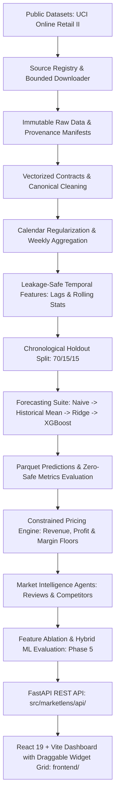

# MarketLens AI — Agentic Dynamic Pricing Intelligence Platform

> **Status:** Phase 6 Complete: Advanced React + Vite Dashboard, FastAPI Integration & End-to-End Application  
> **Source of Truth:** Refer to [MARKETLENS_AI_KNOWLEDGE_BASE.md](file:///d:/Professional%20Projects/Agentic_Dynammic_Intelligence_Platform/MARKETLENS_AI_KNOWLEDGE_BASE.md) and [docs/phase_6_api_integration.md](file:///d:/Professional%20Projects/Agentic_Dynammic_Intelligence_Platform/docs/phase_6_api_integration.md).

---

## 1. Project Overview

**MarketLens AI** is a hybrid Data Science, Machine Learning, and Generative AI decision-support platform for e-commerce and retail pricing. It combines historical sales transaction data, time-aligned customer review sentiment, and observed competitor price movements to forecast demand under candidate prices and produce constrained, auditable pricing recommendations.

MarketLens AI operates strictly on an **evidence-based decision-support model**; recommendations are designed for human review and approval, and the platform does not execute automated live price changes.

---

## 2. Problem Statement

Retail pricing decisions are complex. Sales demand is driven by historical seasonality, price elasticity, promotions, inventory levels, competitor pricing, and qualitative customer sentiment. Traditionally, these signals are trapped in disparate silos:
- Historical demand models ignore qualitative review sentiment and competitor dynamics.
- Manual competitor price matching lacks demand-elasticity context and risks margin erosion.
- Blind price increases risk brand damage and customer churn.

Businesses need an auditable, integrated system that unifies historical sales and validated external signals to predict demand across feasible prices, evaluate trade-offs between revenue and profit objectives, and operate within strict business constraints.

---

## 3. High-Level Architecture

The platform follows a modular, layered architecture:



### Key Architectural Layers:
1. **Source Discovery & Data Engineering:** Provenance tracking, automated bounded downloads, integrity validation, and canonical schema contracts.
2. **Canonical Data Modeling & Feature Store:** Deterministic cleaning of cancellations and non-product codes, continuous Monday-aligned weekly aggregation (`W-MON`), and zero-demand regularization.
3. **Leakage-Safe Feature Engineering:** Lag features ($t-h$) and rolling metrics shifted strictly by the forecast horizon ($h=1$), mathematically proven through perturbation tests.
4. **Demand Forecasting & Baselines:** Strict chronological holdout splits (70% train, 15% validation, 15% test) comparing Naive, Moving Average, Ridge, and XGBoost models across MAE, RMSE, WAPE, and $R^2$.
5. **Constrained Pricing Engine:** Decimal-safe discrete price grid generation, revenue and profit optimization, gross-margin floors, price movement limits, and model-support extrapolation guards with evidence-based explanations.
6. **Market Intelligence Agents (Phase 4):** Structured review insight extraction (LLM with offline mock/rule-based fallback), deterministic competitor price tracking and alerts, and leakage-safe signal aggregation.
7. **Hybrid ML & Feature Ablation (Phase 5):** Four-way controlled feature ablation (E0 Baseline, E1 Reviews, E2 Competitors, E3 Both), anti-leakage temporal alignment ($t_{\text{obs}} \le t_{\text{origin}}$), signed metric deltas, and pricing impact evaluation.
8. **Product & Serving (Phase 6):** Complete FastAPI REST API endpoints connected natively to a high-end, Webflow-inspired React 19 + Vite + TypeScript web dashboard featuring customizable draggable analytics widgets.

---

## 4. Technology Stack

- **Core & Runtime:** Python 3.10+ (tested on Python 3.13) & Node.js 24+
- **Data Engineering:** Pandas, NumPy, PyArrow, PyYAML, Python-Dotenv
- **Machine Learning & Modeling:** Scikit-learn, Scipy, XGBoost
- **API Backend:** FastAPI, Pydantic v2, Uvicorn, Starlette, HTTPX
- **Frontend Dashboard:** React 19, TypeScript, Vite 8, Tailwind CSS, Motion (`motion/react`), Lucide React, Recharts, TanStack Query
- **Testing & Quality:** Pytest (163 tests passing), Vitest (6 tests passing), Pytest-cov, TypeScript Typecheck (`tsc -b`)

---

## 5. Repository Structure

```text
Agentic_Dynammic_Intelligence_Platform/
│
├── MARKETLENS_AI_KNOWLEDGE_BASE.md  # Comprehensive project source of truth
├── README.md                        # Project documentation and guide
├── pyproject.toml                   # Project metadata and dependency definitions
├── .gitignore                       # Rigorous Git exclusions (data, secrets, models)
├── .env.example                     # Environment configuration template
│
├── configs/                         # Modular YAML configurations
│   ├── app.yaml                     # Application & storage settings
│   ├── datasets.yaml                # Source registry & acquisition parameters
│   ├── forecasting.yaml             # Modeling, splits, weekly grain, and metrics
│   ├── pricing.yaml                 # Optimization objectives, grids, & margin constraints
│   ├── agents.yaml                  # Agent settings & LLM provider configurations
│   └── phase5_experiments.yaml      # Feature ablation variants (E0-E3) & evaluation
│
├── data/                            # Segregated data storage (ignored by git)
│   ├── raw/                         # Immutable downloaded source files (git-ignored)
│   ├── processed/                   # Canonical Parquet datasets (git-ignored)
│   │   ├── sales_observations.parquet
│   │   ├── demand_timeseries.parquet
│   │   └── product_catalog.parquet
│   └── manifests/                   # Dataset manifests, checksums, and profile JSONs
│       ├── datasets_manifest.json
│       ├── dataset_candidate_inventory.json
│       ├── derived_data_manifest.json
│       └── profiles/uci_online_retail_ii_profile.json
│
├── docs/                            # In-depth technical documentation
│   ├── development_setup.md         # Step-by-step setup guide
│   ├── phase2_readiness_report.md   # Raw dataset verification audit
│   ├── canonical_data_dictionary.md # Phase 2 schemas and validation contracts
│   ├── forecasting_methodology.md   # Mathematical modeling & anti-leakage proofs
│   ├── dataset_limitations.md       # Empirical truthfulness & absent feature audit
│   ├── phase2_evaluation_report.md  # Full benchmark results & acceptance criteria
│   ├── phase_3_input_audit.md       # Phase 3 readiness and prerequisite audit
│   ├── pricing_engine_design.md     # Pricing optimizer architecture and formulas
│   ├── pricing_engine_limitations.md# Causal boundaries, extrapolation, and governance
│   ├── phase_4_input_audit.md       # Phase 4 data availability and provider audit
│   ├── agentic_intelligence_design.md # Agent workflows, PII defense & schemas
│   ├── market_signal_data_dictionary.md # Canonical signal feature dictionary
│   ├── agent_evaluation_plan.md     # Evaluation benchmarks, injection & joinability gates
│   ├── phase5_readiness_audit.md    # Phase 5 data readiness and prerequisite audit
│   ├── phase5_experiment_protocol.md# Scientific 4-way ablation protocol & deltas
│   ├── phase5_feature_catalog.md    # Canonical feature definitions and missingness policies
│   ├── phase5_results_report.md     # Benchmark evaluation metrics, deltas & conclusions
│   └── datasets/                    # Phase 1 dataset documentation
│       ├── ACQUISITION_REPORT.md    # Full acquisition audit and findings
│       ├── ATTRIBUTION.md           # Formal citations and license register
│       └── DATA_DICTIONARY.md       # Raw column definitions and distributions
│
├── src/marketlens/                  # Core application package
│   ├── __init__.py                  # Package definition
│   ├── config.py                    # Safe YAML config loader & env resolver
│   ├── logging_config.py            # Idempotent logging setup
│   ├── cli.py                       # CLI entry point (datasets, forecasting, pricing, & market)
│   ├── datasets/                    # Phase 1: Discovery, acquisition & profiling
│   │   ├── models.py                # Typed Pydantic models
│   │   ├── registry.py              # Candidate discovery & scoring
│   │   ├── licenses.py              # License hard-gate validation
│   │   ├── downloader.py            # Bounded streaming acquisition (.part)
│   │   ├── integrity.py             # SHA-256 & archive security
│   │   ├── manifests.py             # Provenance serialization
│   │   ├── profiler.py              # Read-only tabular statistics
│   │   └── adapters/                # Source-specific adapters (UCI Online Retail II)
│   ├── data/                        # Phase 2: Contracts, cleaning & aggregation
│   │   ├── contracts.py             # Vectorized schema validation
│   │   ├── loaders.py               # Raw source data loaders
│   │   ├── cleaning.py              # Deterministic cleaning & audit metrics
│   │   ├── canonicalize.py          # Entity normalization & product catalog
│   │   ├── aggregation.py           # Weekly grid alignment & zero imputation
│   │   └── split.py                 # Strict chronological holdout partitioning
│   ├── features/                    # Phase 2 & 5: Feature engineering & signal joins
│   │   ├── temporal.py              # Horizon-shifted lags & perturbation checks
│   │   └── market_signals.py        # Time-aligned review/competitor feature generation & anti-leakage
│   ├── forecasting/                 # Phase 2: Baseline modeling & evaluation
│   │   ├── metrics.py               # Zero-safe MAE, RMSE, WAPE, MASE, R2
│   │   ├── baselines.py             # Naive, Moving Average, Ridge, Random Forest
│   │   ├── evaluate.py              # Split-aware multi-model evaluation
│   │   └── artifacts.py             # Parquet predictions & lineage manifest
│   ├── pricing/                     # Phase 3: Constrained pricing optimizer
│   │   ├── schemas.py               # Pydantic input/output contracts
│   │   ├── candidate_generation.py  # Decimal-safe price grid generation
│   │   ├── constraints.py           # Margin, movement, bounds, and support checks
│   │   ├── objectives.py            # Revenue, profit, and gross margin math
│   │   ├── scenario.py              # Scenario batching & demand predictor adapters
│   │   ├── optimizer.py             # Master optimization loop & tie-breaking
│   │   └── explanation.py           # Deterministic recommendation explanations
│   ├── agents/                      # Phase 4: Agentic market intelligence workflows
│   │   ├── schemas.py               # Pydantic perception, competitor & signal schemas
│   │   ├── review_insights.py       # PII redaction, prompt injection defense, perception extraction
│   │   ├── competitor_monitor.py    # Deterministic price change detection & threshold alerts
│   │   ├── signal_aggregator.py     # Leakage-safe, time-aligned market feature aggregator
│   │   └── service.py               # High-level MarketIntelligenceService coordinator
│   ├── llm/                         # Phase 4: Provider-neutral LLM abstraction
│   │   ├── base.py                  # BaseLLMService and typed error hierarchy
│   │   ├── factory.py               # Config-driven provider instantiation
│   │   ├── mock.py                  # Deterministic offline mock service
│   │   └── rule_based.py            # Lexicon sentiment & aspect extractor fallback
│   └── experiments/                 # Phase 5: Feature ablation and scientific evaluation
│       ├── schemas.py               # Ablation run manifest and variant result models
│       ├── ablation.py              # Master 4-way ablation runner (E0-E3) & pricing evaluator
│       └── run_ablation.py          # Standalone runner entry point
│
├── tests/                           # Complete test suite (151 passing tests)
│   ├── conftest.py                  # Pytest fixtures and cleanup
│   ├── unit/                        # Deterministic unit tests (148 tests)
│   └── integration/                 # End-to-end integration tests (3 tests)
│
├── dashboard/                       # Streamlit application (Phase 6)
└── artifacts/                       # Trained models, predictions, reports (git-ignored)
    ├── phase5/                      # Phase 5 ablation metrics, manifests, and predictions
    └── model_comparison.csv         # Phase 2 baseline models
```

---

## 6. Quick Start & Setup

### Prerequisites
- Python 3.10+ installed (Python 3.13 supported)
- Git installed
- Windows PowerShell or Unix Shell

### Installation Steps

1. **Clone the repository:**
   ```bash
   git clone https://github.com/Gokulnaath-N/MarketLens-Agentic-Dynamic-Pricing-Intelligence-Platform.git
   cd MarketLens-Agentic-Dynamic-Pricing-Intelligence-Platform
   ```

2. **Create and activate a virtual environment:**
   ```powershell
   # Windows PowerShell:
   python -m venv .venv
   .\.venv\Scripts\Activate.ps1
   ```

3. **Install the package in editable mode with all dependencies:**
   ```powershell
   python -m pip install --upgrade pip
   pip install -e ".[dev,data,forecasting]"
   ```

4. **Initialize environment variables:**
   ```powershell
   Copy-Item .env.example .env
   ```

5. **Execute tests to verify installation:**
   ```powershell
   # Run all 163 backend tests:
   python -m pytest

   # Run frontend unit tests:
   cd frontend
   npm run test
   ```

---

## 7. Running the Application (Local Two-Terminal Workflow)

To launch MarketLens AI with the full React + Vite dashboard connected natively to the FastAPI backend:

### Terminal A: FastAPI REST API
```powershell
.\.venv\Scripts\Activate.ps1
python -m uvicorn marketlens.api.main:app --host 127.0.0.1 --port 8000 --reload
```
*Interactive Swagger documentation: [http://127.0.0.1:8000/docs](http://127.0.0.1:8000/docs)*

### Terminal B: React + Vite Web Dashboard
```powershell
cd frontend
npm install
npm run dev
```
*Web dashboard interface: [http://127.0.0.1:5173](http://127.0.0.1:5173)*

---

## 8. Command-Line Interface (CLI)

MarketLens AI provides commands for dataset management, demand forecasting, feature ablation, pricing optimization, and agentic market intelligence:

### Dataset Management
```powershell
# Discover registered candidates and evaluate licensing hard-gates:
python -m marketlens.cli datasets discover

# Check local dataset acquisition status:
python -m marketlens.cli datasets status

# Acquire and verify approved dataset (bounded streaming with SHA-256):
python -m marketlens.cli datasets download --source uci_online_retail_ii

# Profile acquired tabular dataset (read-only):
python -m marketlens.cli datasets profile --source uci_online_retail_ii
```

### Demand Forecasting & Feature Ablation
```powershell
# Run the complete Phase 2 end-to-end forecasting pipeline:
python -m marketlens.cli forecast pipeline --sample-rows 50000 --top-products 50

# Run the Phase 5 4-way feature ablation study (E0 Baseline vs E1 Reviews vs E2 Competitors vs E3 Both):
python -m marketlens.cli forecast ablate --config configs/phase5_experiments.yaml
```

### Constrained Pricing Optimization
```powershell
# Evaluate candidate prices to maximize revenue:
python -m marketlens.cli pricing optimize --product-id uci_85123A --current-price 2.95 --price-min 2.00 --price-max 4.00 --step 0.20 --objective revenue

# Evaluate candidate prices to maximize profit under gross margin floor:
python -m marketlens.cli pricing optimize --product-id uci_85123A --current-price 2.95 --price-min 2.00 --price-max 4.00 --step 0.20 --objective profit --unit-cost 1.50 --min-margin 0.20 --max-change-pct 0.25
```

### Agentic Market Intelligence
```powershell
# Extract structured perception signals from customer review text (offline mode):
python -m marketlens.cli market review --review-text "Excellent build quality and fast shipping, love it!" --product-id PROD-123 --mode rule_based

# Detect deterministic competitor price change and threshold alert:
python -m marketlens.cli market competitor --product-id PROD-123 --competitor-id COMP-A --prev-price 20.00 --curr-price 18.00 --threshold-pct 5.0
```

---

## 9. Development Roadmap

| Phase | Description | Status |
| :---: | :--- | :---: |
| **0** | **Repository Foundation & Environment Setup** | **Completed** |
| **1** | **Dataset Discovery, Rights Review, Acquisition & Profiling** | **Completed** |
| **2** | **Canonical Data Processing & Baseline Demand Forecasting** | **Completed** |
| **3** | **Constrained Pricing Optimization Engine** | **Completed** |
| **4** | **Agentic Market Intelligence & Signal Aggregation** | **Completed** |
| **5** | **Hybrid Feature Evaluation & 4-Way Model Ablation** | **Completed** |
| **6** | **Advanced React + Vite Dashboard & FastAPI Backend** | **Completed** |
| **7** | Production Hardening, Documentation & MLOps | Up Next |

