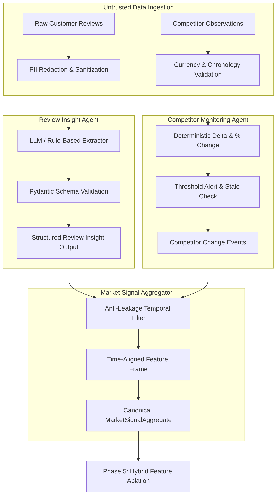

# MarketLens AI — Agentic Market Intelligence Design

**Document Version:** 1.0.0  
**Phase:** Phase 4 (Agentic Market Intelligence)  
**Status:** Approved & Implemented  
**Date:** 2026-10-28  

---

## 1. Executive Overview

Phase 4 implements the **Agentic Market Intelligence Layer** for MarketLens AI, translating raw customer feedback and competitor pricing observations into validated, time-aligned market intelligence signals for decision support and demand forecasting.

### Core Architectural Principles:
1. **Separation of Concerns (Language vs. Arithmetic):**  
   Language models interpret unstructured customer perception (sentiment, aspect extraction, complaint categories). Deterministic Python code executes all mathematical calculations (price changes, percentage deltas, time lookback windows, aggregation ratios, and threshold alerts).
2. **Zero-Secret Offline Mode:**  
   The platform operates 100% offline without requiring paid API keys, utilizing deterministic mock adapters and rule-based lexicon extractors.
3. **Strict Privacy Minimization & PII Redaction:**  
   Customer feedback text undergoes automated regex redaction to strip emails, phone numbers, and order identifiers before processing.
4. **Prompt Injection Defense:**  
   Customer review text and scraped content are treated strictly as untrusted data, never as system instructions.
5. **Temporal Anti-Leakage:**  
   Signals are aligned to an explicit decision timestamp (`as_of_timestamp`). Any review or competitor observation published after this timestamp is purged.

---

## 2. High-Level System Architecture



---

## 3. Workflow Specifications

### 3.1 Customer Review Insight Agent (`review_insights.py`)
- **Sanitization & Redaction:** Replaces email addresses with `[EMAIL_REDACTED]`, phone numbers with `[PHONE_REDACTED]`, and order IDs with `[ORDER_ID_REDACTED]`.
- **Extraction Modes:**
  - `RULE_BASED`: Lexicon-based sentiment scoring ($\in [-1.0, 1.0]$) and keyword aspect mapping (`product_quality`, `value_for_money`, `delivery_shipping`, `customer_service`, `packaging`).
  - `MOCK`: Deterministic schema-valid responses for automated test suites.
  - `LLM`: Configurable provider integration via `BaseLLMService`.
- **Failure Isolation:** Batch processing isolates individual record failures without dropping valid outputs.

### 3.2 Competitor Monitoring Agent (`competitor_monitor.py`)
- **Deterministic Math:**
  $$\text{absolute\_change} = p_{\text{curr}} - p_{\text{prev}}$$
  $$\text{percentage\_change} = 100 \cdot \frac{p_{\text{curr}} - p_{\text{prev}}}{p_{\text{prev}}}$$
- **Threshold Alerts:** Triggers alerts when $|\text{percentage\_change}| \ge \text{threshold\_pct}$ (default 5.0%).
- **Guardrails:** Rejects currency mismatches, chronological inversions ($t_{\text{prev}} > t_{\text{curr}}$), and non-positive prices.

### 3.3 Market Signal Aggregator (`signal_aggregator.py`)
- **Lookback Windows:** Trailing review window (default 30 days) and competitor window (default 7 days).
- **Anti-Leakage Enforcement:** Observations with timestamps $t > \text{as\_of\_timestamp}$ are purged.
- **Quality Statuses:** `AVAILABLE`, `MISSING`, `INSUFFICIENT_SAMPLE`, `STALE`, `SYNTHETIC_ONLY`.

---

## 4. CLI Entry Points

```powershell
# Analyze customer review text:
python -m marketlens.cli market review --product-id uci_85123A --text "Great quality mug, highly durable!" --method rule_based

# Detect competitor price movement:
python -m marketlens.cli market competitor --product-id uci_85123A --competitor-id rival_store --prev-price 10.00 --curr-price 8.50 --threshold 5.0
```
