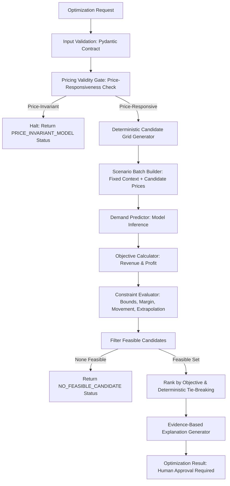

# MarketLens AI — Constrained Pricing Optimization Engine Design

**Document Version:** 1.0.0  
**Phase:** Phase 3 (Constrained Pricing Optimization)  
**Status:** Approved & Implemented  
**Date:** 2026-10-28  

---

## 1. System Overview & Purpose

The **MarketLens AI Constrained Pricing Optimization Engine** translates demand forecasts and commercial rules into auditable, constrained price recommendations.

In accordance with core project principles:
1. **Decision Support Only:** The engine proposes candidate prices with explanations and requires human review (`human_approval_required = True`). It does not execute live repricing.
2. **Deterministic Processing:** All candidate price generation, arithmetic, constraint checks, and rankings use ordinary, strictly tested Python logic.
3. **Fail Closed:** If required inputs (such as unit cost for profit optimization) are missing, the engine fails closed with an actionable validation error rather than inventing arbitrary default values.
4. **Pricing Validity Gate:** The engine checks whether the underlying demand model is sensitive to candidate prices before evaluating candidates. Pure autoregressive lag models that do not vary with candidate price are rejected to avoid trivially picking upper price bounds.

---

## 2. High-Level Engine Architecture



---

## 3. Mathematical Formulations & Objectives

### A. Expected Revenue Maximization
For a candidate selling price $p$ and model-predicted expected demand $\hat{Q}(p)$:
$$\text{ExpectedRevenue}(p) = p \cdot \max(0, \hat{Q}(p))$$

### B. Estimated Contribution Profit Maximization
When a valid, positive wholesale unit cost $c > 0$ is provided:
$$\text{EstimatedProfit}(p) = (p - c) \cdot \max(0, \hat{Q}(p))$$
*Policy Rule:* If `objective="profit"` and $c$ is missing, the request is rejected immediately at validation.

### C. Gross Margin Proportion
$$\text{GrossMargin}(p) = \frac{p - c}{p}$$
*Distinction Note:* Gross margin is defined relative to the selling price $p$. It is mathematically distinct from markup $\frac{p - c}{c}$.

---

## 4. Candidate Grid Generation

Candidate prices are generated using decimal-safe logic to eliminate floating-point accumulation errors:
1. **Bounds:** Generated strictly within $[P_{\min}, P_{\max}]$.
2. **Step Sizing:** If explicit `price_step` is configured, step increments are quantized to currency precision (default 2 decimal places). Otherwise, step is derived from $\frac{P_{\max} - P_{\min}}{\text{num\_candidates} - 1}$.
3. **Endpoint Guarantee:** The upper bound $P_{\max}$ is always guaranteed to be evaluated.
4. **Current Price Inclusion:** If `current_price` lies inside $[P_{\min}, P_{\max}]$, it is inserted into the grid and deduplicated.
5. **Safety Limits:** A hard limit (`max_candidates = 101`) prevents unbounded grid evaluation and memory exhaustion.

---

## 5. Business Constraints & Guardrails

Each constraint is evaluated independently for every candidate price:

| Constraint | Formula / Condition | Violation Action |
| :--- | :--- | :--- |
| **Price Bounds** | $P_{\min} \le p \le P_{\max}$ | Mark infeasible (`Outside configured bounds`) |
| **Price Movement Limit** | $\frac{\|p - p_{\text{current}}\|}{p_{\text{current}}} \le r_{\max}$ | Mark infeasible (`Exceeds permitted price movement`) |
| **Gross Margin Floor** | $\frac{p - c}{p} \ge m_{\text{floor}}$ | Mark infeasible (`Gross margin below required floor`) |
| **Competitor Premium** | $\frac{p - p_{\text{comp}}}{p_{\text{comp}}} \le r_{\text{comp}}$ | Mark infeasible (only when competitor price exists) |
| **Model Training Support** | $P_{\text{train, min}} \le p \le P_{\text{train, max}}$ | Configurable policy: `reject` or `warn` |

---

## 6. Deterministic Tie-Breaking Policy

If multiple feasible candidate prices achieve the maximum objective value within a configured numerical tolerance ($\epsilon = 10^{-4}$):
1. **Primary Tie-Breaker:** Candidate closest in absolute terms to `current_price` ($\min \|p - p_{\text{current}}\|$).
2. **Secondary Tie-Breaker:** Lower candidate price ($\min p$).

---

## 7. Command-Line Interface (CLI) Usage

The engine is callable via the unified MarketLens AI CLI:
```powershell
# Revenue optimization across candidate range:
python -m marketlens.cli pricing optimize --product-id uci_85123A --current-price 2.95 --price-min 2.00 --price-max 4.00 --step 0.20 --objective revenue

# Profit optimization with margin floor and movement constraints:
python -m marketlens.cli pricing optimize --product-id uci_85123A --current-price 2.95 --price-min 2.00 --price-max 4.00 --step 0.20 --objective profit --unit-cost 1.50 --min-margin 0.20 --max-change-pct 0.25
```
